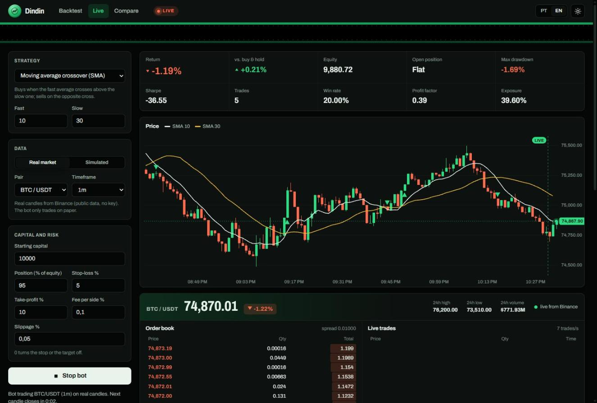

# Dindin

[](../../actions/workflows/tests.yml)


Dindin (Brazilian slang for money) is an algorithmic trading bot written in plain Python. It backtests strategies on real Binance candles, simulated prices or your own CSV, and runs them live on the real market in paper mode, with a web dashboard that shows the order book and trades as they happen.

Leia em português: [README.pt-BR.md](README.pt-BR.md)



> Educational project. It never sends real orders and nothing here is investment advice. Past results, simulated or not, say nothing about future returns.

## Quick start

You need Python 3.10 or newer. There is nothing to install.

```bash
git clone https://github.com/AnthonyVidal-git/dindin.git
cd dindin
python -m dindin serve
```

The dashboard opens at http://127.0.0.1:8000.

## What it does

The dashboard has three modes.

Backtest runs one strategy over up to 5,000 real candles from Binance (BTC, ETH, SOL, BNB, XRP, DOGE, ADA; 1 minute to 1 day), 20,000 candles of seeded synthetic data, or your own CSV file, and shows the price chart with indicators and every order, the equity curve against buy and hold, drawdown, and a table of closed trades.

Live starts the bot on the real market. It loads the last 300 candles, then checks the exchange every 2 seconds and trades each candle as it closes. Next to the chart, the browser connects to Binance's WebSocket streams and shows the order book (top 10 bids and asks with depth bars and buy/sell pressure), every trade as it prints, the 24h ticker and a countdown to the next candle close. The forming candle moves with each real trade. A simulated market is also available, printing a new candle every 0.1 to 1 second, for when you want to watch the bot trade fast.

Compare runs all four strategies on the same data and ranks them.

The strip at the top is the order tape. Each buy and sell is printed there in the order it happened, and clicking one moves the chart to that candle. The interface switches between Portuguese and English and between light and dark themes.

## Strategies

| Key | Strategy | Buys when | Sells when |
| --- | --- | --- | --- |
| `sma_cross` | Moving average crossover | fast SMA crosses above slow SMA | fast SMA crosses below slow SMA |
| `rsi` | RSI mean reversion | RSI drops below the oversold level | RSI rises above the overbought level |
| `macd` | MACD momentum | MACD line crosses above its signal | MACD line crosses below its signal |
| `bollinger` | Bollinger band reversion | close falls below the lower band | close rises above the middle band |

Every parameter can be changed from the dashboard or the command line.

## Real market data

All market data comes from Binance's public endpoints, so there is no account and no API key, and the bot cannot send orders. The server uses the REST API (`/api/v3/klines`) through the public mirror `data-api.binance.vision`, falling back to `api.binance.com`, and pages backwards to fetch more than the 1,000-candle limit per request. The browser reads the `depth10`, `aggTrade` and `ticker` WebSocket streams and reconnects with backoff, alternating hosts, if the connection drops. If the exchange can't be reached when the page opens, the dashboard falls back to simulated data.

## How the simulation works

The engine trades long only, one position at a time. A signal is computed on a candle's close and filled at that close, moved against you by the slippage setting, so a strategy never sees a price from a later candle. A test checks this: running on the first 300 candles and on all 400 must produce the same orders for the first 300.

Stop-loss and take-profit are checked against each later candle's high and low. If a candle opens past the stop, the fill happens at the open, which is worse than the stop price, the same way a gap works in a real market. When a candle touches both levels, the engine assumes the stop was hit first. Fees are charged on both sides.

The synthetic market is a geometric Brownian motion that switches between up, down and sideways regimes. A seed fixes the path, so the same seed always gives the same result.

Reported metrics: total return, buy and hold return, CAGR, Sharpe and Sortino (annualized from the candle interval), maximum drawdown, win rate, profit factor, average, best and worst trade, and exposure (share of candles spent in a position).

## Command line

```bash
python -m dindin backtest --strategy rsi --bars 2000 --seed 3
python -m dindin backtest --csv examples/sample_prices.csv --strategy sma_cross --param fast=20 --param slow=50
python -m dindin compare --seed 7
python -m dindin backtest --symbol BTCUSDT --timeframe 1h --bars 3000
python -m dindin compare --symbol ETHUSDT --timeframe 4h --bars 1500
python -m dindin serve --port 9000 --no-browser
```

`python -m dindin --help` lists every option.

## Using your own data

Any CSV with `time` (or `date`/`timestamp`), `open`, `high`, `low` and `close` columns works. Volume is optional, header case does not matter, and times can be ISO dates or unix seconds or milliseconds. [examples/sample_prices.csv](examples/sample_prices.csv) shows the format (its prices are synthetic).

## Project layout

```
dindin/
  data.py         candles, synthetic market, CSV parser
  indicators.py   SMA, EMA, RSI, MACD, Bollinger bands
  strategies.py   the four strategies and their parameter limits
  engine.py       order execution, risk rules, backtest runner
  metrics.py      Sharpe, Sortino, drawdown and the rest
  market.py       real market data from Binance's public REST API
  live.py         background thread for live paper trading (real or simulated)
  server.py       JSON API and static file server (standard library only)
  __main__.py     command line interface
web/              dashboard: HTML, CSS and JavaScript modules, charts drawn on canvas
tests/            unit and HTTP tests
examples/         sample CSV
```

## API

| Method | Path | Body |
| --- | --- | --- |
| GET | `/api/health` | |
| GET | `/api/strategies` | |
| GET | `/api/market` | supported symbols and timeframes |
| POST | `/api/backtest` | `strategy`, `params`, `risk`, `initial_cash`, `bars`, and `source: "binance"` with `symbol`/`timeframe`, or `seed`, or `csv` |
| POST | `/api/compare` | same as backtest, without `strategy` |
| POST | `/api/live/start` | `strategy`, `params`, `risk`, `initial_cash`, and `source: "binance"` with `symbol`/`timeframe`, or `seed`/`interval` |
| POST | `/api/live/stop` | |
| GET | `/api/live?since=N` | returns the live state and fills from index `N` |

Invalid input returns HTTP 400 with an `error` message, and an unreachable exchange returns 502. The server binds to 127.0.0.1 unless you pass `--host`.

## Tests

```bash
python -m unittest discover -s tests
```

The suite covers the indicators against hand-computed values, order execution with and without costs, stop and target fills (including gaps), look-ahead bias, CSV parsing, the market client (offline, with a fake exchange: paging, host fallback, closed versus forming candles, the live loop), every API route, input validation and path traversal on the static server. pytest also runs it. GitHub Actions runs the tests on Python 3.10 to 3.13.

## Adding a strategy

Subclass `Strategy` in `dindin/strategies.py`, declare its parameters, implement `warmup` and `signal`, and add it to `STRATEGIES`. The dashboard picks it up from `/api/strategies`; add its label to `web/js/i18n.js` for both languages.

```python
class Breakout(Strategy):
    key = "breakout"
    label = "Donchian breakout"
    params_spec = (Param("period", 20, 5, 200),)

    @property
    def warmup(self):
        return self.params["period"] + 1

    def signal(self, closes):
        window = closes[-self.params["period"] - 1 : -1]
        if closes[-1] > max(window):
            return BUY
        if closes[-1] < min(window):
            return SELL
        return HOLD
```

## License

MIT. See [LICENSE](LICENSE).
