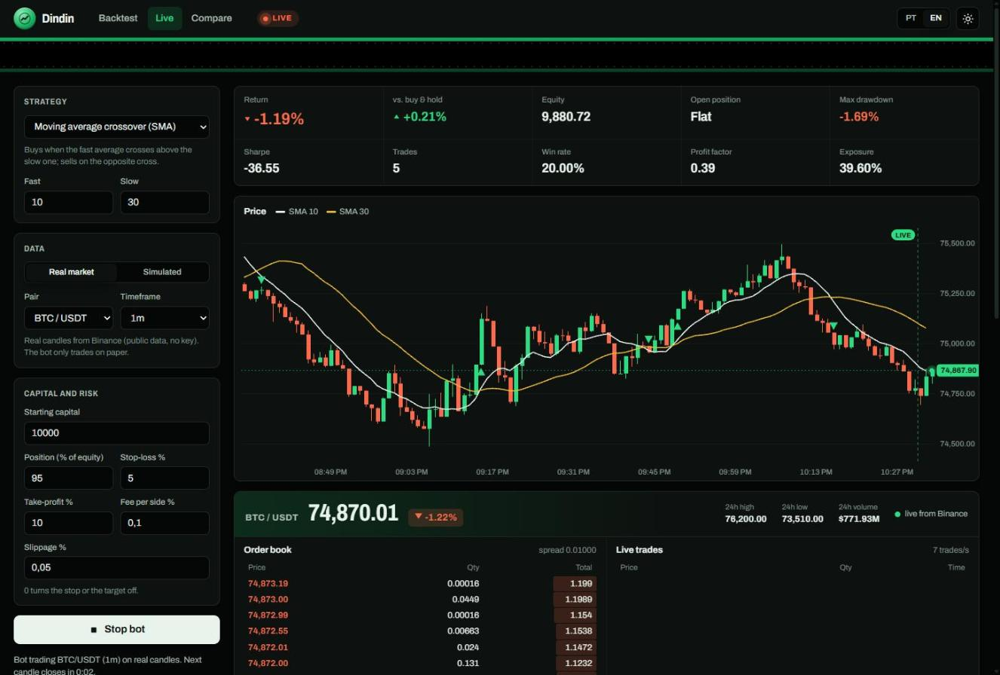

# Dindin

[](../../actions/workflows/tests.yml)


Dindin é um robô de trading algorítmico escrito em Python puro. Ele faz backtest de estratégias em candles reais da Binance, em preços simulados ou no seu CSV, e opera ao vivo no mercado real em modo papel, com um painel web que mostra o livro de ofertas e os negócios acontecendo.

Read in English: [README.md](README.md)



> Projeto educacional. Nenhuma ordem real é enviada e nada aqui é recomendação de investimento. Resultado passado, simulado ou não, não garante retorno futuro.

## Como rodar

Precisa de Python 3.10 ou mais novo. Não há nada para instalar.

```bash
git clone https://github.com/AnthonyVidal-git/dindin.git
cd dindin
python -m dindin serve
```

O painel abre em http://127.0.0.1:8000.

## O que ele faz

O painel tem três modos.

Backtest roda uma estratégia em até 5.000 candles reais da Binance (BTC, ETH, SOL, BNB, XRP, DOGE, ADA; de 1 minuto a 1 dia), em até 20.000 candles simulados (com semente) ou no seu próprio CSV. Mostra o gráfico de preço com indicadores e cada ordem, a curva de patrimônio contra o buy and hold, o drawdown e uma tabela com as operações fechadas.

Ao vivo liga o robô no mercado real. Ele carrega os últimos 300 candles, consulta a corretora a cada 2 segundos e opera cada candle assim que ele fecha. Ao lado do gráfico, o navegador se conecta aos WebSockets da Binance e mostra o livro de ofertas (10 melhores ofertas de compra e venda, com barras de profundidade e pressão compradora), cada negócio no momento em que acontece, o ticker de 24h e a contagem até o próximo candle. O candle em formação se mexe a cada negócio real. Também dá pra usar um mercado simulado, que imprime um candle a cada 0,1 a 1 segundo, pra ver o robô operando rápido.

Comparar roda as quatro estratégias nos mesmos dados e monta um ranking.

A faixa no topo é a fita de ordens. Cada compra e venda é impressa ali na ordem em que aconteceu, e clicar numa delas leva o gráfico até aquele candle. A interface alterna entre português e inglês e entre tema claro e escuro.

## Estratégias

| Chave | Estratégia | Compra quando | Vende quando |
| --- | --- | --- | --- |
| `sma_cross` | Cruzamento de médias | a SMA rápida cruza acima da lenta | a SMA rápida cruza abaixo da lenta |
| `rsi` | RSI, reversão à média | o RSI cai abaixo da sobrevenda | o RSI sobe acima da sobrecompra |
| `macd` | MACD, momentum | a linha MACD cruza acima do sinal | a linha MACD cruza abaixo do sinal |
| `bollinger` | Bandas de Bollinger | o fechamento cai abaixo da banda inferior | o fechamento volta acima da média |

Todos os parâmetros podem ser alterados no painel ou na linha de comando.

## Dados reais de mercado

Os dados vêm dos endpoints públicos da Binance: não precisa de conta nem de chave, e o robô não consegue enviar ordens. O servidor usa a API REST (`/api/v3/klines`) pelo espelho público `data-api.binance.vision`, com `api.binance.com` de reserva, e pagina para trás para buscar mais que o limite de 1.000 candles por requisição. O navegador lê os streams `depth10`, `aggTrade` e `ticker` por WebSocket e reconecta sozinho, alternando servidores, se a conexão cair. Se a corretora estiver inacessível quando a página abre, o painel usa dados simulados.

## Como a simulação funciona

O motor opera só comprado, uma posição por vez. O sinal é calculado no fechamento do candle e executado nesse fechamento, ajustado contra você pelo slippage, então a estratégia nunca vê um preço de um candle posterior. Um teste confere isso: rodar nos primeiros 300 candles e em todos os 400 precisa gerar as mesmas ordens nos 300 primeiros.

Stop-loss e take-profit são checados contra a máxima e a mínima dos candles seguintes. Se o candle abre além do stop, a execução sai na abertura, que é pior que o preço do stop, como num gap de mercado de verdade. Quando um candle toca os dois níveis, o motor considera que o stop veio primeiro. A taxa é cobrada na compra e na venda.

O mercado sintético é um movimento browniano geométrico que alterna entre regimes de alta, baixa e lateral. A semente fixa o caminho dos preços, então a mesma semente sempre dá o mesmo resultado.

Métricas: retorno total, retorno do buy and hold, CAGR, Sharpe e Sortino (anualizados pelo intervalo dos candles), drawdown máximo, taxa de acerto, fator de lucro, operação média, melhor e pior, e exposição (fração dos candles com posição aberta).

## Linha de comando

```bash
python -m dindin backtest --strategy rsi --bars 2000 --seed 3
python -m dindin backtest --csv examples/sample_prices.csv --strategy sma_cross --param fast=20 --param slow=50
python -m dindin compare --seed 7
python -m dindin backtest --symbol BTCUSDT --timeframe 1h --bars 3000
python -m dindin compare --symbol ETHUSDT --timeframe 4h --bars 1500
python -m dindin serve --port 9000 --no-browser
```

`python -m dindin --help` lista todas as opções.

## Usando seus próprios dados

Serve qualquer CSV com as colunas `time` (ou `date`/`timestamp`), `open`, `high`, `low` e `close`. Volume é opcional, maiúsculas no cabeçalho não importam e as datas podem ser ISO ou unix em segundos ou milissegundos. O arquivo [examples/sample_prices.csv](examples/sample_prices.csv) mostra o formato (os preços dele são sintéticos).

## Estrutura

```
dindin/
  data.py         candles, mercado sintético, leitor de CSV
  indicators.py   SMA, EMA, RSI, MACD, Bandas de Bollinger
  strategies.py   as quatro estratégias e os limites dos parâmetros
  engine.py       execução de ordens, regras de risco, backtest
  metrics.py      Sharpe, Sortino, drawdown e as demais métricas
  market.py       dados reais da API pública da Binance
  live.py         thread em segundo plano para o modo ao vivo (real ou simulado)
  server.py       API JSON e arquivos estáticos (só biblioteca padrão)
  __main__.py     linha de comando
web/              painel: HTML, CSS e módulos JavaScript, gráficos desenhados em canvas
tests/            testes unitários e de HTTP
examples/         CSV de exemplo
```

## Testes

```bash
python -m unittest discover -s tests
```

Os testes cobrem os indicadores contra valores calculados à mão, execução com e sem custos, stop e alvo (inclusive gaps), viés de antecipação (look-ahead), leitura de CSV, o cliente de mercado (offline, com uma corretora falsa: paginação, troca de servidor, candle fechado e em formação, o loop ao vivo), todas as rotas da API, validação de entrada e path traversal no servidor de arquivos. O pytest também roda a suíte. O GitHub Actions executa os testes no Python 3.10 a 3.13.

## Criando uma estratégia

Crie uma subclasse de `Strategy` em `dindin/strategies.py`, declare os parâmetros, implemente `warmup` e `signal` e registre em `STRATEGIES`. O painel carrega a lista de `/api/strategies`; coloque o nome dela em `web/js/i18n.js` nos dois idiomas. O [README em inglês](README.md#adding-a-strategy) tem um exemplo completo.

## Licença

MIT. Veja [LICENSE](LICENSE).
